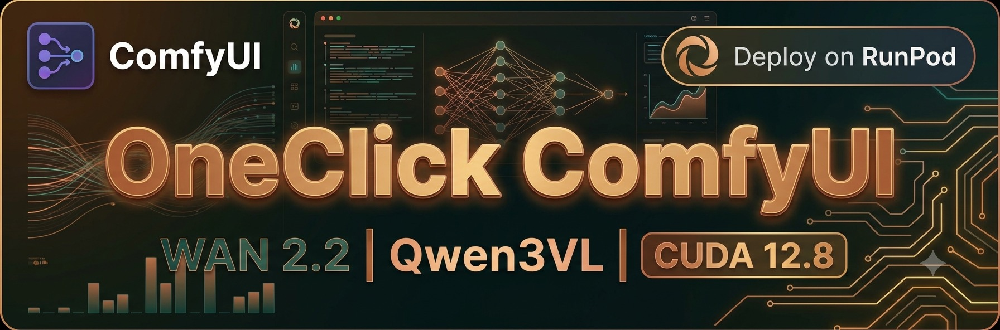

# OneClick - ComfyUI - WAN2.2 Uncensored

Custom ComfyUI based on our own base image `huchukato/comfyui-base:cu128`, enhanced with QwenVL-Mod and WAN 2.2 video generation. Compatible with RTX 4090 (Ada) and RTX 5090 (Blackwell).

> ⚠️ **DEPRECATED** — This template uses the CUDA 12.8 base image, which is no longer built or maintained. Use the WAN 2.2 templates on the CUDA 13 base instead.

**Template**: `OneClick - ComfyUI - WAN2.2 Uncensored - CU128` *(archived)*

---

## 🚀 Features

- **WAN 2.2 Video**: T2V, I2V, FL2V, SVI, Story workflows (up to 20s)
- **Multilingual prompts** with visual style detection
- **GGUF backend** via llama-cpp-python CUDA 12.8
- **Sage Attention**, FP16 accumulation, async offload
- **TensorRT** upscaling and frame interpolation (CUDA 12 wheels pre-baked)
- **SVI LoRA** (Stable Video Infinity v2 PRO — High & Low)
- **Persistent** `/workspace` (models survive restarts)
- **Auto-update** ComfyUI core at boot

---

## 📦 What's Included

### Base Image `huchukato/comfyui-base:cu128`
CUDA 12.8, PyTorch 2.10+cu128, Python 3.12, ComfyUI core, Manager (legacy UI), KJNodes, Civicomfy, RunpodDirect, FileBrowser, Jupyter, SSH.

### Custom Nodes (22)
QwenVL-Mod, RIFE-TensorRT-Auto, Upscaler-TensorRT-Auto, HuggingFace, PerfectVideoResolution, Euler-Smea-Dyn-Sampler, was-node-suite, VideoHelperSuite, rgthree-comfy, Easy-Use, Frame-Interpolation, mxToolkit, PainterI2V, PainterLongVideo, Selectors, GGUF, MMAudio, VFI, WanMoeKSampler, comfy_mtb, ComfyUI-TagForge.

### Pre-baked Models (~5GB)
- VAE: `wan_2.1_vae.safetensors`, `sdxl_vae.safetensors`
- Text encoder: `nsfw_wan_umt5-xxl_fp8_scaled.safetensors`

### Downloaded at Boot (~62GB, persistent)
- 4× WAN Remix diffusion models (T2V High/Low, I2V High/Low)
- 2× SVI v2 PRO LoRA (High & Low)
- NSFW text encoder

> Background download on first boot. ComfyUI starts immediately; models appear when ready. No re-download on restart.

### Workflows (8)
WAN 2.2 T2V, I2V (5s/20s), FL2V, SVI (20s), Story I2V/SVI/T2V-I2V. All with Qwen3.5 auto-prompting.

---

## 🛠️ Requirements

- **GPU**: **RTX PRO 6000**, **H100 NVL**, **H200** or **A100 80GB** recommended
- **VRAM**: **48 GB+ minimum**, **80 GB+ recommended** for the default full-quality workflows (10Eros FP8, full Gemma text encoders, etc.)
- **Multi-GPU**: two **RTX 5090** (2×32 GB) meet the 48 GB minimum if your deployment supports multiple GPUs and the workflow/nodes use both; otherwise a single 32 GB card is too small for the default workflows
- **Storage**: 100 GB+ SSD

---

## 🚀 Quick Start

1. **Deploy**: Select "OneClick ComfyUI WAN2.2 Qwen3VL CUDA 12.8"
2. **First boot**: ComfyUI copies to `/workspace` (~30s), WAN models download in background
3. **Access**:
   - ComfyUI: `http://pod-ip:8188`
   - JupyterLab: `http://pod-ip:8888`
   - FileBrowser: `http://pod-ip:8080` (user `admin` / password `adminadmin12`)
   - SSH: `ssh root@pod-ip`

---

## Qwen Chat

Open it from the ComfyUI sidebar. GUI: **EN/IT**; generated prompts: English. Default: Qwen3.8 9B Q8 GGUF, downloaded on first use. Qwen reads workflow images or a priority **Attach image** reference. It uses exposed prompt/passthrough controls when available. **Repeat**, choices, thinking and automatic VRAM unload are included.

---

## ⚙️ ComfyUI Args

Pre-populated in `/workspace/runpod-slim/comfyui_args.txt`:
```
--disable-auto-launch --fast fp16_accumulation --use-sage-attention --cuda-malloc --async-offload
```

Edit via FileBrowser or Jupyter to customize.

---

## 🔄 Persistence

`/workspace/runpod-slim/ComfyUI` survives restarts: models, nodes, workflows, output, user data. No re-downloads on restart.

---

## 📊 CUDA 12.8 vs 13.0

| | CUDA 12.8 | CUDA 13.0 |
|---|---|---|
| **GPU** | RTX 4090 + 5090 | RTX 5090+ |
| **TensorRT** | 10.13.3.9 | 10.15.1.29 |
| **llama-cpp-python** | v0.3.45+cu128 | v0.3.45+cu130 |
| **Base image** | `huchukato/comfyui-base:cu128` | `huchukato/comfyui-base:cu130` |

Choose CUDA 12.8 if you need RTX 4090 support. Choose CUDA 13.0 for RTX 5090-only with latest TensorRT.

---

Based on RunPod official template with QwenVL-Mod enhancements.
